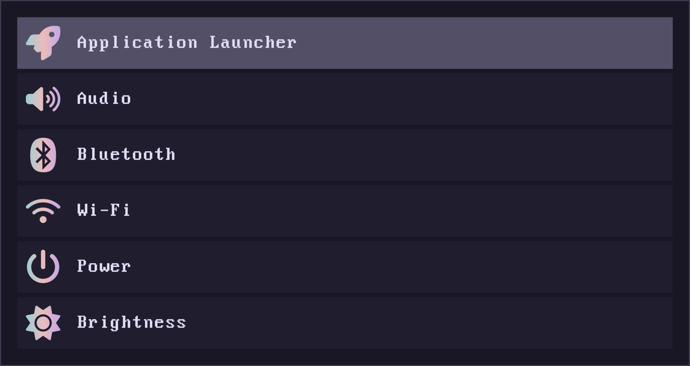
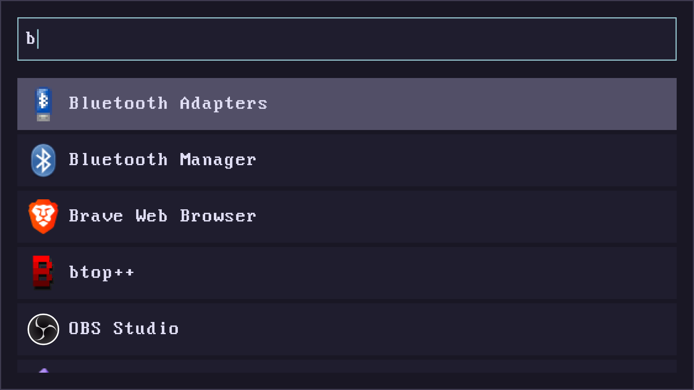
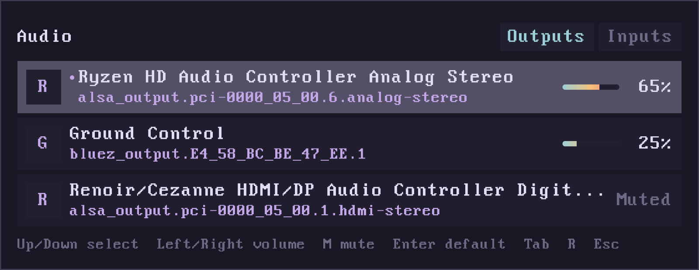
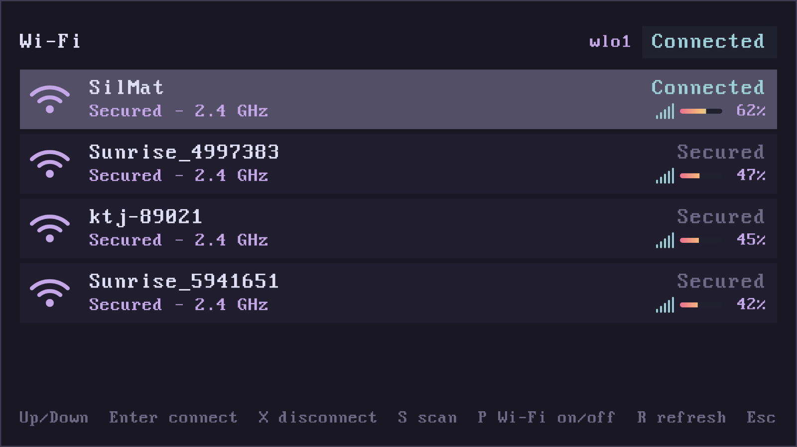
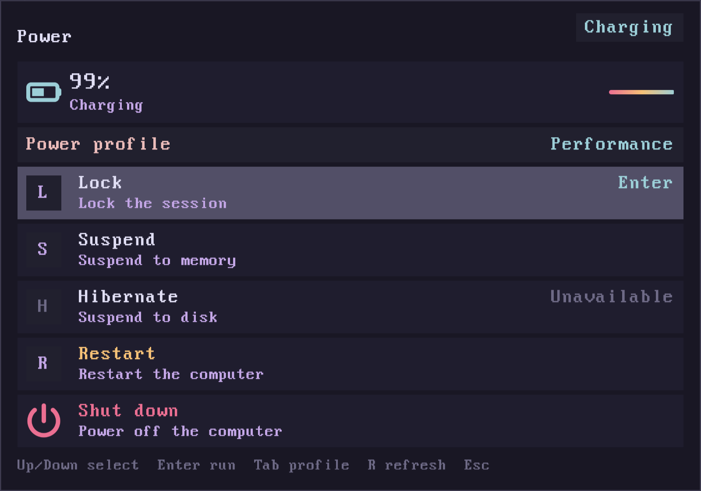
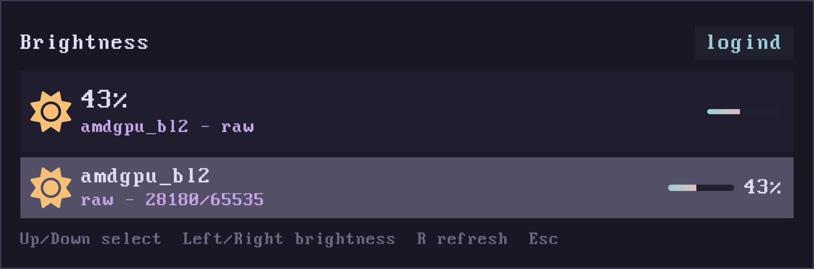

# iube

## What is iube?

iube is a small, dependency-light control panel for the Linux desktop. It opens
fast, draws its own UI, and keeps nothing running in the background.

The development philosophy is to stay extremely fast and lightweight: no
application toolkit, no resident daemon, and no tool-specific client libraries.
The tools talk to the kernel and system services directly. See
[Design goals and philosophy](#design-goals-and-philosophy).

## The name

**iube** comes from Latin *iubeō, iubēre* ("to order, command"). It is the
second-person singular present active imperative, meaning **"command!"** or
**"order!"**.

Classical Latin: **[ˈjʊ.beː]**, roughly **YOO-beh**.

## Features

Each command builds only the view it needs. The control panel does not scan
`.desktop` files, the launcher does not build the panel, and every tool is
separate from the others. All commands share the same config at
`~/.config/iube/config`, the same theme, scaling, font, renderer and layer-shell
window setup.

| Tool | Command | Preview | Open | Peak RSS |
| --- | --- | --- | ---: | ---: |
| Control panel | `iube` |  | 5.5 ms | 14.4 MB |
| Application launcher | `iube launch` |  | 7.8 ms | 14.4 MB |
| Audio | `iube audio` |  | 9.6 ms | 14.4 MB |
| Bluetooth | `iube bluetooth` |  | 7.7 ms | 14.4 MB |
| Wi-Fi | `iube wifi` |  | 11.9 ms | 14.4 MB |
| Power | `iube power` |  | 16.5 ms | 14.4 MB |
| Brightness | `iube brightness` |  | 7.5 ms | 14.4 MB |

Measurements are produced by [docs/measure.py](docs/measure.py). The script runs
five measurements after one warm-up. Open time is measured from process start to
the compositor mapping the iube layer surface through Hyprland's IPC socket.
Peak RSS is the maximum resident set reported by `wait4`. The numbers above come
from a `--release=fast` build with Zig 0.17.0 on NixOS 26.05, AMD Ryzen 7 5800H,
Hyprland, on a 1920×1080 output at 1× scale. The previews were captured with
`scale = 2.0` on a 2560×1600 output.

### Commands

Commands that open a window share the layer-shell setup. Actions print a short
result and exit without connecting to Wayland, loading the theme or creating a
surface. Optional percentages are integers from 0 to 100 and default to 5.

| Command | Effect |
| --- | --- |
| `iube` | Open the control panel. |
| `iube panel` | Open the control panel (same view). |
| `iube launch` | Open the application launcher. |
| `iube audio` | Open the audio controller. |
| `iube bluetooth` | Open the Bluetooth controller. |
| `iube wifi` | Open the Wi-Fi controller. |
| `iube power` | Open the power controller. |
| `iube brightness` | Open the brightness controller. |
| `iube help`, `iube --help`, `iube -h` | Print usage and exit. |
| `iube version`, `iube --version`, `iube -V` | Print `iube 0.1.0` and exit. |

| Action | Effect |
| --- | --- |
| `iube audio volume-up [percent]` | Raise the default output by `percent` (default 5), clamped to 100. |
| `iube audio volume-down [percent]` | Lower the default output by `percent` (default 5), clamped to 0. |
| `iube audio mute` | Toggle mute on the default output. |
| `iube audio mic-mute` | Toggle mute on the default input. |
| `iube audio default <name>` | Make the matching sink or source the default; matches name or description case-insensitively. |
| `iube bluetooth power <state>` | Set the first adapter's power; `state` is `on`, `off` or `toggle`. |
| `iube bluetooth discover <state>` | Start or stop discovery; `state` is `on` or `off` (`toggle` is rejected). |
| `iube bluetooth connect <name-or-address>` | Connect a known device. |
| `iube bluetooth disconnect <name-or-address>` | Disconnect a device. |
| `iube bluetooth pair <name-or-address>` | Pair using a just-works agent; no passkey or PIN. |
| `iube bluetooth forget <name-or-address>` | Remove the device from the adapter. |
| `iube bluetooth list` | Print the adapter and known devices. |
| `iube wifi on`, `iube wifi off`, `iube wifi toggle` | Set NetworkManager's wireless state. |
| `iube wifi scan` | Request a scan, wait 1.5 seconds and print the networks. |
| `iube wifi list` | Print the current wireless state and networks. |
| `iube wifi connect <ssid> [--password-stdin]` | Activate a saved profile or create one, prompting for a password on stdin. |
| `iube wifi disconnect` | Disconnect the wireless device. |
| `iube power suspend` | Suspend through logind. |
| `iube power hibernate` | Hibernate through logind. |
| `iube power reboot` | Restart through logind. |
| `iube power poweroff` | Shut down through logind. |
| `iube power lock` | Lock the current session. |
| `iube power battery` | Print battery percentage, status and AC state. |
| `iube power profile next` | Select the next advertised power profile. |
| `iube power profile set <profile>` | Select an advertised profile: `low-power`, `power-saver`, `balanced` or `performance`. |
| `iube brightness up [percent]` | Raise the selected backlight by `percent` (default 5), clamped to 100. |
| `iube brightness down [percent]` | Lower the selected backlight by `percent` (default 5), clamped to 0. |
| `iube brightness set <percent>` | Set the selected backlight to 0–100%. |
| `iube brightness get` | Print the selected backlight device and percentage. |
| `iube brightness list` | Print every backlight device, percentage, type and raw range. |

Actions exit `0` on success, `1` on a backend or state error, and `2` on invalid
syntax. See [docs/usage/index.md](docs/usage/index.md).

More information about each feature lives under
[docs/usage](docs/usage/index.md): [panel](docs/usage/panel.md),
[launcher](docs/usage/launcher.md),
[audio](docs/usage/audio.md), [Bluetooth](docs/usage/bluetooth.md),
[Wi-Fi](docs/usage/wifi.md), [Power](docs/usage/power.md),
[Brightness](docs/usage/brightness.md),
[configuration](docs/usage/config.md), [usage index](docs/usage/index.md), and
[architecture](docs/architecture/overview.md).

## Design goals and philosophy

- **One binary, one process per invocation.** No resident daemon, no index, no
  database, no search server. Close the window and the process is gone.
- **No application toolkit.** The UI is written directly against Wayland and
  composited by hand into `wl_shm` memory. The only linked libraries are libc,
  `libwayland-client` and `libxkbcommon`.
- **No tool-specific client libraries.** The managers speak the underlying
  protocols directly: the PulseAudio socket, BlueZ and NetworkManager over
  D-Bus, sysfs, and logind's D-Bus interface. System services such as PipeWire,
  BlueZ, NetworkManager, wpa_supplicant and logind are still expected to be
  running. iube does not replace them.
- **Shared visual language.** Theme, config, scaling, fonts, icons and window
  chrome are shared by every command.

## Requirements

iube requires a Wayland compositor that advertises `zwlr_layer_shell_v1`. That
is what gives every iube tool the same native, centred overlay window with
exclusive keyboard focus, without compositor-specific rules. Layer-shell is
supported by Hyprland, Sway and other wlroots compositors, KDE Plasma/KWin,
Wayfire, labwc, River, niri and many Mir-based compositors. It is not supported
by GNOME/Mutter, Weston or X11 sessions.

See [docs/usage/launcher.md](docs/usage/launcher.md#layer-shell-is-required) for
the full explanation.

The Wi-Fi controller additionally requires NetworkManager to be running and to
manage the wireless interface. NetworkManager owns the supplicant and saved
profiles; iube only reads their state over D-Bus.

## Installation

### From source

Building iube requires Zig 0.17.0, the Wayland development headers and the
libxkbcommon development headers. The generated Wayland protocol bindings for
`wlr-layer-shell` and `cursor-shape` are checked into `src/protocol`, so
`wayland-scanner` and `wayland-protocols` are not build dependencies.

```sh
zig build --release=fast
./zig-out/bin/iube
```

With no arguments the built binary opens the control panel. Use
`./zig-out/bin/iube launch` for the application launcher. Every tool also has
non-UI actions for keybinds and status bars; see [Commands](#commands).

### With Nix

If Nix is installed, the flake provides the package directly:

```sh
nix build .#iube
./result/bin/iube
```

### NixOS

Add iube as a flake input:

```nix
{
  inputs.iube.url = "github:mvicarius/iube";
}
```

Pass the package set to your configuration through `specialArgs`:

```nix
specialArgs = {
  iube = iube.packages.x86_64-linux;
};
```

Then install the package in `configuration.nix`:

```nix
environment.systemPackages = with pkgs; [
  iube.iube
];
```

Apply the configuration with your normal rebuild command, for example:

```sh
sudo nixos-rebuild switch --flake .#nixos
```

Replace `x86_64-linux` with your system if needed.

## Credits

The control-panel icons come from **Font Awesome Free 6.7.2** by Fonticons,
Inc. They are embedded in the binary as 128×128 PNGs and tinted with the active
theme. The icons are licensed under CC BY 4.0; see
[`src/icons/LICENSE-font-awesome.txt`](src/icons/LICENSE-font-awesome.txt) for
source paths and attribution.
