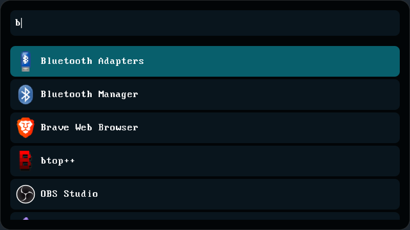

# iube

A small application launcher for Wayland. It reads `.desktop` files, shows
their names and PNG icons, filters as you type, and launches the selected
command.

The UI is written directly against Wayland and renders into `wl_shm` shared
memory. There is no SDL, no GL, no dvui and no widget toolkit: the only
libraries are `libwayland-client` and `libxkbcommon`.



## Why iube?

iube is built for the moment between pressing a shortcut and getting on with
your work. It is one process with one job: read the `.desktop` files, draw a
list, launch the chosen command.

- **Opens in under 15 ms.** Measured from process start to the compositor
  mapping its layer surface, a ReleaseFast build has a median launch time of
  **11.2 ms** (10.5–12.8 ms across five runs). Filtering and selection redraws
  are sub-millisecond.
- **Under 10 MB of RAM.** **8.4 MB** resident after the window opens with 34
  desktop entries loaded. Icon decoding is lazy: only the icons for rows that
  are actually drawn are decoded.
- **Dependency-free.** `build.zig.zon` has no package dependencies. There is no
  GTK, Qt, SDL, OpenGL, FreeType/HarfBuzz, Rust/Node runtime or vendored
  dependency tree behind it: just Zig's standard library, libc, and the two
  libraries every Wayland desktop already has, `libwayland-client` and
  `libxkbcommon`.
- **Nothing left running.** Close iube and the process is gone. It keeps no
  index, database or search server resident between launches.

### How it compares

Measured on the same machine, same desktop, same 34 `.desktop` entries and
default configuration. Launch is the median of five runs, from process start
(or the service request) to the compositor mapping the window. Memory is
resident set size after the window has settled.

| Launcher | Launch (median) | Resident memory | How it runs |
| --- | ---: | ---: | --- |
| **iube** | **11.2 ms** | **8.4 MB** | one process per launch |
| fuzzel | 21.1 ms | 18.2 MB | one process per launch |
| rofi | 45.3 ms | 28.5 MB | one process per launch |
| wofi | 61.5 ms | 44.2 MB | one process per launch |
| Vicinae | 6.1 ms | 336.6 MB | server and helpers stay resident |
| Walker | 43.6 ms | 413.8 MB | Walker service and Elephant stay resident |

The memory column is the whole footprint needed to open the launcher: for
Walker it includes the Walker service and the Elephant data source; for Vicinae
it includes the Vicinae server and its helper processes. Their launch times are
low because those services are already running after login; starting them cold
is additional work not included here. That is the normal post-login comparison
for a daemon-backed launcher, and it is also why their resident footprint stays
in the hundreds of megabytes even when the window is closed. iube has no warm
service to pay for: every launch is a fresh process, and the process exits when
you close it.

Fuzzel is the closest single-process comparison. iube uses about half its
resident memory and avoids the pixel/font stack that fuzzel links (pixman and
fcft).

**Measurement notes.** Five runs after one warm-up, on Hyprland 0.55 with a
2560×1600 output at 1.25× scale, using the compositor's `openlayer` event and
`ps -o rss`. iube was built with `-Doptimize=ReleaseFast`; the other launchers
were their Nixpkgs release builds. All used their default configuration, with
no tuning applied. RSS is summed per process, so multi-process launchers count
shared library pages once per process. Values vary with the number of installed
`.desktop` files, icons and providers.

## Build

For a normal release build:

```sh
nix develop --command zig build -Doptimize=ReleaseFast
./zig-out/bin/iube
```

Or, to build and run in one step:

```sh
nix develop --command zig build run -Doptimize=ReleaseFast
```

A plain `zig build` produces a Debug build. It is fine while developing, but
uses more memory; the figures above are from a ReleaseFast build.

The build needs `wayland` and `libxkbcommon` development headers. The
generated protocol bindings for `wlr-layer-shell` and `cursor-shape` are
checked into `src/protocol`, so `wayland-scanner` and `wayland-protocols` are
not build dependencies.

This project requires Zig **0.17.0**. The flake tracks `nixos-unstable`, which
currently ships that version.

## Controls

- Type to filter the list.
- `Up` / `Down` select an entry, `Enter` launches it.
- Click a row to launch it.
- Mouse wheel scrolls the list.
- Press `Esc` to close.

## Layer-shell is required

**Layer-shell is needed for optimal working of the application.** iube creates
its window as a `zwlr_layer_shell_v1` overlay surface: that is what gives it a
native Wayland, centred 640×360 window with exclusive keyboard focus, without
any compositor-specific window rule.

Layer-shell is supported by:

- Hyprland, Sway and other wlroots-based compositors
- KDE Plasma / KWin
- Wayfire, labwc, River, niri
- many Mir-based compositors (some need
  `--add-wayland-extension zwlr_layer_shell_v1`)

It is **not** supported by GNOME/Mutter, Weston, or X11 sessions. On those,
iube exits with `LayerShellUnavailable` rather than opening a normal tiled
window. Core Wayland (`xdg-shell`) has no portable way to request a floating,
centred overlay, so there is no useful fallback.

## Window behaviour

iube creates an **overlay layer surface** sized 640×360, centred on the
focused output, with exclusive keyboard focus. No compositor configuration is
required.

## Implementation notes

- **Rendering.** Every frame is composited by hand into a premultiplied
  ARGB8888 `wl_shm` buffer: rounded rectangles with analytic antialiasing,
  a built-in bitmap font, and PNG icons.
- **HiDPI.** iube listens for `wl_surface.preferred_buffer_scale` and renders
  at the compositor's preferred integer scale, so text and icons stay crisp.
- **Font.** Text uses an embedded 8×16 VGA-derived bitmap font with Latin-1
  coverage. There is no FreeType/HarfBuzz dependency. Characters outside the
  font are rendered as `?`.
- **Icons.** Only PNG icons are used. The scanner prefers the icon closest to
  32 px and falls back to a coloured box with the app's initial. PNGs are
  decoded lazily with Zig's standard-library zlib decoder.
- **Desktop entries.** It scans `/usr/share`, `/run/current-system/sw/share`,
  `XDG_DATA_DIRS`, and `XDG_DATA_HOME` (falling back to
  `~/.local/share`), ignoring `Hidden=true` / `NoDisplay=true`.
- **Launching.** `%f`-style field codes are removed and the command is handed
  to `sh -c`, so shell quoting and environment assignments work as written in
  the `.desktop` file.
- **Terminal apps.** Entries with `Terminal=true` are run inside `$TERMINAL`
  when it is set (split on whitespace, with terminal-specific `-e`/`--`/`start`
  handling); otherwise iube tries Ghostty, Kitty, Foot, Alacritty, WezTerm,
  XTerm, Konsole, GNOME Terminal, and `xdg-terminal-exec`. If no terminal can
  be started, iube reports an error instead of running the TUI app invisibly.
- **Input.** Keyboard handling uses the compositor-provided xkb keymap plus
  `libxkbcommon`. Key repeat is implemented on the client, and mouse pointer
  cursor shapes come from `cursor-shape-v1`. Text is appended at the end of
  the query (backspace and `Ctrl+U` are supported); clipboard paste and IME
  are not implemented.
